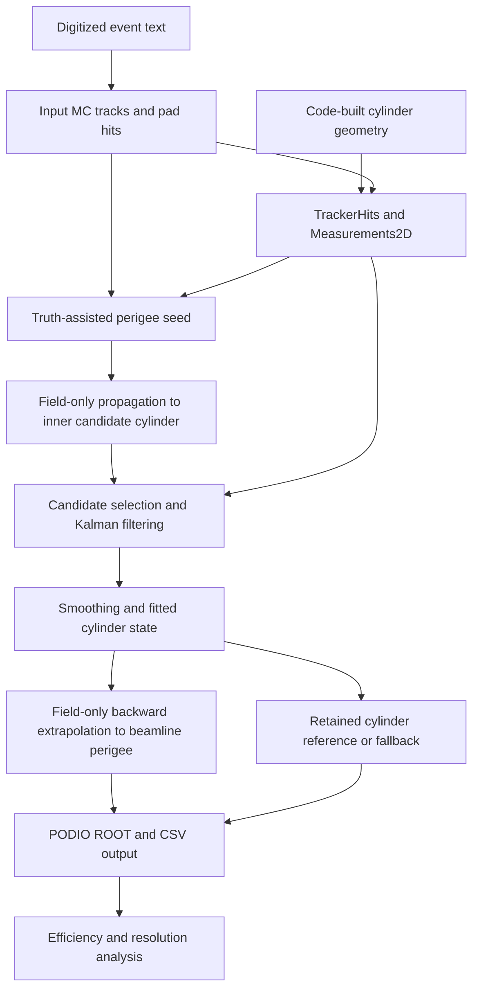
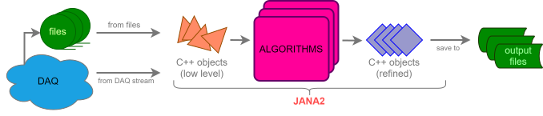
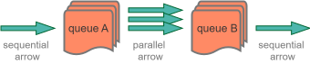
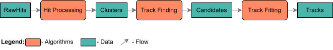
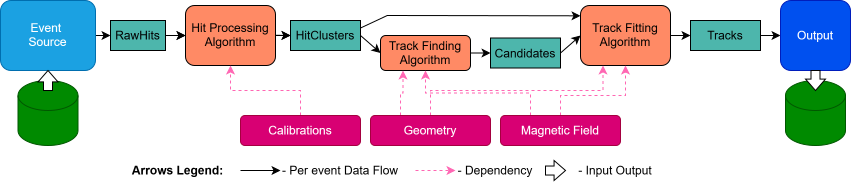
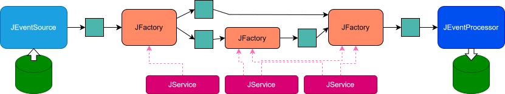

# Tracking architecture

This page describes the current executable after the tracking/output fixes.
The application is assembled in [main.cpp](../source/tdis/main.cpp): JANA services
provide geometry/logging, factories produce event collections on demand, and
processors request the fitted tracks and write the output. The chain currently
performs **truth-assisted fitting**, with greedy hit-candidate selection.
Independent hit-only seeding, clustering, CKF branching and vertex reconstruction
are future work.

See the [output schema](schema.md) for field definitions and relations,
[runtime flags](flags.md) for settings, [CSV format](csv.md) for exports,
and [performance workflow](tracking-performance.md) for run/plot commands.
The [accuracy study](tracking-accuracy-study.md) records the controlled tests,
measured results and remaining limitations.

## End-to-end data flow



| Stage | Active code | Products / behavior |
| --- | --- | --- |
| Input | [DigitizedDataEventSource.hpp](../source/tdis/io/DigitizedDataEventSource.hpp) | `EventInfo`, `DigitizedMtpcMcTracks`, `DigitizedMtpcMcHits` |
| Geometry | [ActsGeometryService.cpp](../source/tdis/geometry/ActsGeometryService.cpp), [BuildCylindricalDetector.cpp](../source/tdis/geometry/BuildCylindricalDetector.cpp), [TdisGeometryHelper.hpp](../source/tdis/geometry/TdisGeometryHelper.hpp) | Ring cylinders, pad centres and readout-plane z coordinates |
| Hits and seed | [TruthTracksSeedsHitsFactory.cpp](../source/tdis/tracking/TruthTracksSeedsHitsFactory.cpp) | `TrackerHits`, `Measurements2D`, `TruthTrackParameters`, `TruthTrackSeeds` |
| Fit | [KalmanFittingFactory.cpp](../source/tdis/tracking/KalmanFittingFactory.cpp), [LayerCandidateCalibrator.h](../source/tdis/tracking/LayerCandidateCalibrator.h) | Filtering, smoothing, selected measurement provenance and KF summary |
| Reference conversion | [FittedTrackOutput.h](../source/tdis/tracking/FittedTrackOutput.h) and fitter | Perigee transport, Cartesian covariance, cylinder fallback; `FittedTrajectories`, `FittedTrackParameters`, `FittedTracks` |
| Output | [PodioWriteProcessor.hpp](../source/tdis/io/PodioWriteProcessor.hpp), [CsvWriteProcessor.hpp](../source/tdis/io/CsvWriteProcessor.hpp) | PODIO ROOT and four CSV files with a shared `tdis:output` prefix |
| Analysis | [run_tracking_performance.py](../python/run_tracking_performance.py), [plot_tracking_performance.py](../python/plot_tracking_performance.py) | Reconstruct events, then relation-matched efficiency, residual and phi reports |

## 1. Read digitized input

The current reader treats each text event as one MC track. Track headers give
momentum [GeV], theta/phi [degrees], and vertex z [m]. Hit rows contain arrival
time [ns], ADC, ring/pad/plane indices and `zToGem` [m], with optional true XYZ [m].
The supported row layouts are:

```text
track header: p theta phi vertex_z
hit without truth XYZ: time adc ring pad plane zToGem
hit with truth XYZ:    time adc true_x true_y true_z ring pad plane zToGem
```

The reader converts lengths to mm and angles to radians, sorts hits by arrival
time and filters sentinel ring/pad indices. Missing true XYZ is stored as NaN.
It does not simulate digitization or convert TDC to z. Its `EventInfo` uses the
JANA counter, run 22 and timeslice 0; the original text event label is not saved.
Records without hits can be skipped, so requested and processed counts need
separate reporting. See [schema identity rules](schema.md#file-and-collection-layout).

## 2. Build geometry and measurements

The active geometry is constructed in code, not read from `g4sbs_mtpc.root`.
`TGeoGeometryService` registration is disabled in `main.cpp`. There are 21
concentric cylindrical measurement surfaces along z, within the 50–150 mm annulus
and total length 550 mm. Ring width is `(150−50)/21 = 4.7619 mm`; each surface
lies at its ring centre. The layer thickness is a geometry/navigation property,
not a measured radial coordinate or radial error bar.

Pad centres use 122 pads per ring, with a half-pitch stagger on odd rings.
The ten readout-plane positions in the helper are specified in cm and converted
to mm. **Input plane ID** selects the plane coordinate; it is not the hit's
ordinal position in the event.

By default, finite input true XYZ is used; otherwise the digitized position is:

```text
x,y = getPadCenter(ring,pad)
z = plane_positions[plane] + zToGem   for even planes
z = plane_positions[plane] - zToGem   for odd planes
```

`acts:use_true_hit_position=false` forces the digitized path. Each accepted hit
produces one `TrackerHit` and one cylinder-bound `Measurement2D`. Position is
stored globally, while the covariance and fit coordinates are local `(Rφ,z)`.
The azimuthal error assumes uniform position across the pad width. The current
drift/timing values give sigma_z = 0.5 mm and Var(z) = 0.25 mm²; see the
[schema covariance definitions](schema.md#input-and-reconstructed-hit-fields).
No extra coordinate smearing is added. Invalid plane IDs, unusable fallback
coordinates and failed surface projection cause the hit to be skipped.

## 3. Initialize a truth-assisted seed

For each input MC track with at least three surviving hits, the factory creates
one seed. This hit requirement does not enforce three independent layers:
all surviving hits and measurements, including repeated pads, remain candidates.
The seed uses truth direction and a near-axis vertex `(0,0,vertexZ)`;
`use_first_hit_as_vertex` is an optional debug override, disabled by default.
Momentum is smeared by a fractional Gaussian, default 10%. The initial charge
is +1 and the ACTS fitting hypothesis is proton.
Seed time comes from the earliest input-hit arrival and is not a calibrated
particle flight time.

The bound seed is defined at closest approach to the origin z-axis. Its q/p
variance follows `(momentum_smear × q/p_seed)²` by default; a nonnegative
absolute-variance override remains available. Other seed covariance terms are
configured separately. With zero smearing, the derived q/p variance is zero;
use an absolute variance when testing free curvature recovery.

The standalone factory uses a random-device seed unless configured. The
performance runner uses fixed RNG seed 42 and one thread for reproducible
comparisons. [Flags](flags.md#active-seed-study-controls) give the active names.

## 4. Select candidates and run the KF

The default field is constant signed Bz = −4.7 T, configurable at runtime.
Its sign matches the observed input bending under the existing positive-charge
seed convention; upstream charge/species and absolute field-sign confirmation
remain necessary for physical labels.

The tracking world is annular: its central region is not covered by a tracking
volume. The fitter therefore transports the perigee seed and covariance through
the field to the innermost candidate cylinder **without geometry navigation**,
then starts the normal ACTS navigator there. Arrival-time sorting in the input
is not used as a flight-order model for the cylinder traversal.

All measurements on a cylinder are retained as candidates, including multiple
hits at the same pad with different drift times. One representative source link
per surface starts the ordinary KF. At the first visit, the calibrator chooses
one candidate using:

```text
residual = measured(u,z) − predicted(u,z)
S = predicted_local_covariance + measurement_covariance
chi2 = transpose(residual) × inverse(S) × residual
```

The u residual is wrapped around the cylinder circumference. The minimum-chi²
valid candidate is selected and its identity cached for subsequent backward
processing; the selected source link preserves the original measurement relation.
This is greedy selection, not CKF branching. Unselected candidates are not
classified as rejected outliers. Only the two spatial coordinates are fitted;
drift time is not a third independent measurement of z.

The fitter uses the gain-matrix updater and smoother, with the first accepted
measurement reference strategy. An innovation outlier finder rejects the chosen
candidate before its update when `chi2_cut > 0` and χ² exceeds that limit;
the default zero leaves finite-χ² rejection disabled. Outlier χ² and original
measurement links are retained. Extra reverse filtering is not enabled
by the current zero momentum threshold. Energy loss and multiple scattering
are disabled, and navigation resolves sensitive surfaces without material/passive
surfaces. A successful return is not a statistical track-quality selection.

## 5. Smooth, extrapolate and export

If ACTS returns filtered measurements without a fitted reference after a final
layer outlier, explicitly smooth the existing chain and bind the first accepted
state. This recovery requires all requested cylinders to have been visited;
incomplete navigation remains a failure. No seed parameters replace fitted states.

After smoothing, the fitted cylinder reference and its covariance are retained.
The output code separately propagates this fitted state backward through the
same field to closest approach to the z-axis, with no geometry/material lookup
and a 10 m path limit. This allows field-only perigee output despite the hollow
tracking world; it does not implement a central material/beam-pipe volume.

On success, the trajectory stores the perigee first and the cylinder second,
and `FittedTracks.type=0`. On failure, it keeps only the cylinder and sets
`FittedTracks.type=1`. An earlier fitting/seed-propagation failure produces no
fitted track. Position, momentum, time and covariance refer to the same primary
state. The proton hypothesis used for fitting is preserved in the output.
Cartesian covariance uses the surface-specific Jacobian with all correlations,
including the signed q/p derivative. Exact type/surface meanings and packed
covariance order are in the [schema reference](schema.md).

`PREFIX.tdisedm.root` retains source, seed, measurement and fit collections and
their PODIO relations. CSV exports are `PREFIX.seeds.csv`, `PREFIX.hits.csv`,
`PREFIX.fitted_tracks.csv` and `PREFIX.track_states.csv`. The state CSV contains
reference states, not the full predicted/filtered/smoothed history; unavailable
path length and reference-state measurement χ² are NaN. Event-selective
`diagnostic_event` logging supplies layer innovations, prediction covariance,
flags and q/p values; `-2` selects all events. The
[hit diagnostic plotter](../python/plot_kf_diagnostics.py) independently checks
candidate χ² in explicit `--processed` mode using these outputs. Its default
readout display instead reads only a raw digitized text file, supporting both
six- and nine-column hits. Each event PDF contains only populated readout planes,
with one plane per page; `--event N` selects the original text label (or the
processed JANA event ID in `--processed` mode).
An inclusive `--event-range FIRST LAST` overlays those events per plane;
hit colors show input TDC/arrival time [ns] on a shared scale.

## 6. Evaluate performance

The runner defaults to 100 events; current validation studies explicitly use
1,000. The analyzer requires schema 102 and joins fitted track → trajectory →
seed → MC through PODIO relations. Every truth track in processed events enters
the efficiency denominator, including seedless and failed fits. Only valid
perigees enter residual distributions; cylinder fallbacks are counted separately.
There is no additional analysis chi², minimum-layer, residual or charge-sign
selection. Reconstruction may apply the optional innovation gate.

Reports show dp/p, theta, wrapped phi and signed radial DCA = perigee loc.a,
with full-sample SD, central 68% width and Gaussian core fits. Phi-bin and
momentum/theta-controlled harmonic checks diagnose angular dependence.
See the [minimal commands](../python/README.md) and
[complete analysis definitions](tracking-performance.md#definitions-and-selection).

## Current scope and remaining work

These are truth-assisted fits, not detector-only resolution or independent
pattern-recognition efficiency. Low-layer/short-lever-arm tracks can depend
strongly on the seed prior. The current model still needs calibrated clustering,
charge-sharing correlations, drift diffusion/calibration errors, radial-bin
projection studies, branching and hit-only seeding, and a full field/material
and central navigation model.

The exported `ndf` counts measured coordinates, so its ratio is not conventional
reduced χ². ADC is still copied into `TrackerHit.edep`, despite its energy label.
Original text event labels and physical particle/charge information are not
preserved by the input model. These are documented limitations, not completed
fixes; [schema](schema.md) explains their effect on analysis, and the
[accuracy study](tracking-accuracy-study.md) records the latest numerical checks.

## Framework background and original design

The sections below provide general ACTS/JANA context and the original design
motivation. The implemented stages and limitations above describe the current
TDIS executable.

### Implementation concepts

[approach.md](approach.md ':include')

## ACTS possibilities 

ACTS provides a whole chain of tracking tasks, such as:
- digitization, 
- clustering, 
- seeding, 
- track fitting, 
- vertexing, 
- calibration and alignment
- various tools, tunings, data model etc. etc. etc. 

It also usually has multiple algorithmic options for each of these tasks,
such as "what seeding algorithm to use?", "what fitting algorithm to use?",
"do we use forward, reverse, or both-way passes?". 

But also, it utilizes machine learning and AI elements, 
such as AI for tracking, which can optionally be turned on during the later stage 
of the software development.

Implementing full ACTS possibilities for TDIS experiment is such 
multi-modal-complexity tasklist, that cannot be implemented easily in place at once. 
So, we decided which steps are important to start with and which steps should be implemented next. 
In particular, we decided that:

- The first step we need to do to implement correctly working track fitting. 
- And after this, move to the track finding. 
- After this, having track finding and track fitting correctly working in the modes close to what we expect from the experiment, move to the vertexing and other options.


To implement this, we initially will use truth seeding. Here it is explained. 
Since seeding is not going to be implemented in the first order,
but track fitting algorithms need some seeding;
initially we will use smeared initial truth track parameters
as a seeding input for the fitting.

Here we come to an important point.
What data is required for ACTS in order to do these first major steps, such as seeding, track-finding, and vertexing?

## Inputs and outputs

As of now we can divide the information needed in several categories:

- information of hits
- information on magnetic fields, 
- and we need information about the geometry.
  - geometry related to hits
  - geometry needed to create material map

In future, other information such as calibration and alignment constants will be also needed.

[Tracking in a nutshell](https://acts.readthedocs.io/en/latest/tracking.html) has 
a good explanation about the interconnection between these categories. 

[ACTS documentation on Event Model](https://acts.readthedocs.io/en/latest/core/eventdata/index.html): 


## Track fitting


ACTS measurements use local coordinates on reference surfaces. The current
TDIS fit uses two local coordinates on cylinders; the surface need not be a
flat XY plane. Geometry connects global hit positions to those local coordinates.

For many tracking detectors, such as, for example, pixel detectors, this conversion is pretty straightforward, as you have a tracking-sensitive plane and you have elements on it. 

But things are not such straight forward for detectors such as TPC detectors. 

In particular, multi-TPC chambers for TDIS experiment. For such type of detectors to make acts library work, you have to use some kind of virtual surfaces to convert real 3D hit positions to local measurement coordinates.

For TDIS geometry consisting of discs and discs consisting of rings and rings consisting of individual parts, we use cylinder geometry representation for ACTS. Cylinders go in Z direction. And their radius corresponds to the center of pads.

---

## Links to mentioned packages:


- **ACTS (A Common Tracking Software)**: https://acts-project.github.io/

- **TDIS (Jefferson Lab repository)**: https://github.com/JeffersonLab/tdis

- [GitHub](https://github.com/JeffersonLab/tdis ':target=_blank')

### C++ ACTS + JANA2 based tracking for TDIS experiment


## Core Architecture




At its core, JANA2 views data processing as a chain of transformations, 
where algorithms are applied to data to produce more refined data. 
This process is organized into two main layers:

1. **Queue-Arrow Mechanism:** JANA2 utilizes the [arrow model](https://en.wikipedia.org/wiki/Arrow_\(computer_science\)), 
   where data starts in a queue. An "arrow" pulls data from the queue, processes it with algorithms, 
   and places the processed data into another queue. The simplest setup involves input and output queues 
   with a single arrow handling all necessary algorithms. But JANA2 supports more complex configurations 
   with multiple queues and arrows chained together, operating sequentially or in parallel as needed.

   

2. **Algorithm Management within Arrows:** Within each arrow, JANA2 organizes and manages algorithms along with their
  inputs and outputs, allowing flexibility in data processing. Arrows can be configured to distribute the processing
  load across various algorithms. By assigning threads to arrows, JANA2 leverages modern hardware to process data 
  concurrently across multiple cores and processors, enhancing scalability and efficiency.

In organizing, managing, and building the codebase, JANA2 provides:

- **Algorithm Building Blocks:** Essential components like Factories, Processors, Services and others, 
  help write, organize and manage algorithms. These modular units can be configured and combined to construct 
  the desired data processing pipelines, promoting flexibility and scalability.

- **Plugin Mechanism:** Orthogonal to the above, JANA2 offers a plugin mechanism to enhance modularity and flexibility. 
  Plugins are dynamic libraries with a specialized interface, enabling them to register components with the main application.
  This allows for dynamic runtime configuration, selecting or replacing algorithms and components without recompilation,
  and better code organization and reuse. Large applications are typically built from multiple plugins, 
  each responsible for specific processing aspects. Alternatively, monolithic applications without plugins 
  can be created for simpler, smaller applications.


## Building blocks

The data analysis application flow can be viewed as a chain of algorithms that transform input data into the 
desired output. A simplified example of such a chain is shown in the diagram below:



In this example, for each event, raw ADC values of hits are processed: 
first combined into clusters, then passed into track-finding and fitting algorithms, 
with the resulting tracks as the chain's output. In real-world scenarios, 
the actual graph is significantly more complex and requires additional components such as Geometry, 
magnetic field maps, calibrations, alignments, etc. 
Additionally, some algorithms are responsible not only for processing objects in memory 
but also for tasks such as reading data from disk or DAQ streams 
and writing reconstructed data to a destination. 
A more realistic and complex flow can be represented as follows:




To give very brief overview algorithm building blocks, how this flow is organized in JANA2 : 

- **JFactory** - This is the primary component for implementing algorithms (depicted as orange boxes). 
  JFactories compute specific results on an event-by-event basis. 
  Their inputs may come from an EventSource or other JFactories. 
  Algorithms in JFactories can be implemented using either Declarative or Imperative approaches 
  (described later in the documentation).

- **JEventSource** - A special type of algorithm responsible for acquiring raw event data, 
  and exposes it to JANA for subsequent processing. For example reading events from a file or listening 
  to DAQ messaging producer which provides raw event data.  

- **JEventProcessor** - Positioned at the top of the calculation chain, JEventProcessor is designed 
  to collect data from JFactories and handle end-point processing tasks, such as writing results to 
  an output file or messaging consumer. However, JEventProcessor is not limited to I/O operations; 
  it can also perform tasks like histogram plotting, data quality monitoring, and other forms of analysis.

  To clarify the distinction: JFactories form a lazy directed acyclic graph (DAG), 
  where each factory defines a specific step in the data processing chain. 
  In contrast, the JEventProcessor algorithm is executed for each event. 
  When the JEventProcessor collects data, it triggers the lazy evaluation of the required factories, 
  initiating the corresponding steps in the data processing chain.

- **JService** - Used to store resources that remain constant across events, such as Geometry descriptions, 
 Magnetic Field Maps, and other shared data. Services are accessible by both algorithms and other services.


We now may redraw the above diagram in terms of JANA2 building blocks:




## Data model

JANA2 alows users to define and select their own event models,
providing the flexibility to design data structures to specific experimental needs. Taking the above
diagram as an example, classes such as `RawHits`, `HitClusters`, ... `Tracks` might be just a user defined classes.
The data structures can be as simple as:

```cpp
struct GenericHit {
double x,y,z, edep;
};
```

A key feature of JANA2 is that it doesn't require data being passed around 
to inherit from any specific base class, such as JObject (used in JANA1) or ROOT's TObject. 
While your data classes can inherit from other classes if your data model requires it, 
JANA2 remains agnostic about this. 

JANA2 offers extended support for PODIO (Plain Old Data Input/Output) to facilitate standardized data handling,
it does not mandate the use of PODIO or even ROOT. This ensures that users can choose the most suitable data management
tools for their projects without being constrained by the framework.


