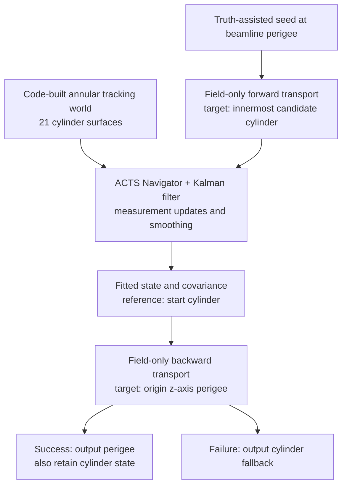

# mTPC geometry and fitted-perigee workflow

Inspected 2026-10-23 by ChatGPT6, including the current uncommitted fitter changes. The current TDIS Docker/ACTS 42.1.1 environment remains the chosen baseline. This note explains the implementation; it does not change geometry or reconstruction. Line references below refer to this inspected worktree.

The current geometry is a hollow tracking world: 50 ≤ r ≤ 150 mm and |z| ≤ 275 mm. The beam-axis region r < 50 mm is outside that world. TDIS handles this by using field-only propagation on both sides of the geometry-guided fit.



## 1. Geometry construction: service → surfaces → layers → world

[main.cpp](../source/tdis/main.cpp), lines 114–119, registers ActsGeometryService; TGeoGeometryService registration is commented out. [ActsGeometryService.cpp](../source/tdis/geometry/ActsGeometryService.cpp), lines 300–306, calls:

```cpp
gGeometry = tdis::tracking::buildCylindricalDetector(
    m_log, nominalContext, m_detector_cylinders);
```

The active tracking geometry is not converted from g4sbs_mtpc.root. The code that constructs it is [BuildCylindricalDetector.cpp](../source/tdis/geometry/BuildCylindricalDetector.cpp).

The dimensions at lines 76–81 give:

```text
Rmin = 50 mm
Rmax = 150 mm
Lz = 550 mm; half-length = 275 mm
N = 21 rings

ΔR = (Rmax − Rmin)/N = 4.76190476 mm
Ri = Rmin + (i + 1/2) ΔR,     i = 0, …, 20

R0  = 52.38095238 mm
R20 = 147.61904762 mm
```

Each measurement surface is an entire cylinder at Ri, spanning −275 ≤ z ≤ 275 mm. The ten readout-plane positions used in hit decoding do not divide these surfaces into ten separate tracking volumes.

The object hierarchy is:

```text
TrackingGeometry
└── TPCVolume = highest/world TrackingVolume, an annulus
    └── radial LayerArray
        ├── active CylinderLayer 0
        │   └── SurfaceArray containing one CylinderSurface
        ├── …
        └── active CylinderLayer 20
            └── SurfaceArray containing one CylinderSurface

m_detector_cylinders[ring] separately retains each MtpcDetectorElement.
Each detector element owns its CylinderSurface.
```

| Construction | Source location | Meaning |
| --- | --- | --- |
| CylinderBounds(Ri, halfLength) | Builder line 101 | Defines each cylindrical surface's radius and z extent. |
| MtpcDetectorElement with identity transform | Builder lines 110–118 | Cylinders are concentric with the global z-axis; element lifetime is retained by the service map. |
| Actual CylinderSurface | [MtpcDetectorElement.cpp](../source/tdis/geometry/MtpcDetectorElement.cpp), line 25 | Creates the surface associated with that detector element. |
| Single-surface SurfaceArray | Builder line 126 | One sensitive surface per ring. |
| Active CylinderLayer, thickness ΔR | Builder lines 129–135 | Adds navigation-layer structure around the measurement surface. Thickness is not a radial measurement error. |
| Equidistant radial LayerArray | Builder lines 147–153 | Organizes the 21 layers for navigation. The preceding log message says “arbitrary,” but the executed argument is equidistant. |
| CylinderVolumeBounds(Rmin,Rmax,halfLength) | Builder line 159 | The tracking volume excludes the central cylinder. |
| TrackingVolume with no child volumes | Builder lines 168–175 | Builds TPCVolume with the layers and homogeneous argon volume material. |
| TrackingGeometry(trackingVolume) | Builder line 180 | Makes that annulus the world; there is no enclosing filled world or central sibling volume. |

The builder checks that the stored surfaces can be retrieved through their ACTS geometry IDs at lines 185–195. Ring index and ACTS geometry ID are distinct identifiers; measurements store the latter.

A radial cross-section of the *implemented* model is:

```text
axis         no tracking volume             TPCVolume
r=0 ────────────────────────── r=50 │ surfaces at 52.38 … 147.62 │ r=150
            central gap             21 active cylindrical layers
```

## 2. A hit becomes a cylinder-local measurement

[TruthTracksSeedsHitsFactory.cpp](../source/tdis/tracking/TruthTracksSeedsHitsFactory.cpp), lines 99–120, selects true XYZ when enabled and available, otherwise pad-centre XY plus the plane/drift-distance z estimate. Lines 159–180 retrieve the ring's cylinder and call globalToLocal.

For an identity-transform cylinder:

```text
φposition = atan2(y, x)
u = Ri × φposition
v = z

measurement m = [u, v]
bound state b = [loc0, loc1, φdirection, θdirection, q/p, ct]
on a cylinder: loc0 = u, loc1 = v
```

Position azimuth and momentum azimuth are different quantities. The fitter measures the first two state coordinates; the trajectory determines the direction.

The assigned spatial covariance is:

```text
V = diag(σu², σz²)
σu² = padWidth² / 12
σz² = 0.25 mm² by default
```

The code accepts some off-radius truth points through a surface tolerance, then uses their cylinder-local coordinates. It does not retain an independent radial measurement/error. Neither the layer thickness nor the accepted projection tolerance supplies that missing covariance.

In [KalmanFittingFactory.cpp](../source/tdis/tracking/KalmanFittingFactory.cpp), lines 103–138, the surface ID is resolved, a source link is made and the 2D measurement/covariance is copied into ACTS. One representative source link is provided per cylinder; all candidates remain available to the calibrator.

## 3. Seed perigee → first candidate cylinder

The truth-assisted seed starts at the origin z-axis perigee. The default seed vertex is (0,0,truthVertexZ), with truth direction and smeared truth momentum. The seed factory's lines 251–265 use a straight-line closest-approach construction:

```text
n = (sinθ cosφ, sinθ sinφ, cosθ)
a = −(vx nx + vy ny)/(nx² + ny²)
rseed = v + a n
```

Here a is a path-length parameter, not the hit time. With the default vx = vy = 0, a = 0. This seed construction is distinct from the curved fitted-track extrapolation below. For the optional off-axis first-hit seed override, it is only a straight-line PCA approximation.

The fitter creates the target perigee surface at the global origin at lines 159–162 and copies the seed into a bound state at lines 292–301. The full covariance is copied too; its time row and column are converted from ns to ACTS ct units at lines 246–249.

It then selects:

```text
Rstart = min(radius of every cylinder represented in this seed's measurements)
```

This loop is at lines 168–179. Rstart is not necessarily ring 0: it is the innermost cylinder with a candidate measurement. It is independent of input drift-time sorting and is not an “earliest hit in time” choice.

The central-gap workaround is explicit at lines 303–311:

```cpp
using SeedPropagator = Acts::Propagator<Stepper>;
SeedPropagator seedPropagator{Stepper(seedField)};
SeedPropagator::Options<> seedOptions(geoContext, magContext);
auto propagatedSeed =
    seedPropagator.propagate(initialParameters, *startSurf, seedOptions);
```

Stepper is SympyStepper. This propagator has no geometry-aware Acts::Navigator; it propagates through the magnetic field to an explicitly supplied surface. The seed path uses the default forward direction. A failed propagation or absent end parameters causes the track to be skipped at lines 312–315.

Conceptually:

```text
bstart = Tseed→cylinder(bseed)
Pstart = Jseed→cylinder Pseed Jseed→cylinderᵀ
```

The Jacobian includes field transport and changes of surface-bound coordinates. There are no measurements or material corrections on this segment. Covariance transport still occurs.

The constant field is B = (0,0,Bz), with Bz = −4.7 T by default. It is supplied independently of tracking-volume membership. The missing volume therefore does not mean missing field.

## 4. Fit and smooth inside the annulus

The active fitter uses:

```cpp
using Propagator = Acts::Propagator<Acts::SympyStepper, Acts::Navigator>;
```

See [KalmanFittingFactory.h](../source/tdis/tracking/KalmanFittingFactory.h), lines 39–41. In the implementation, lines 380–389 configure that navigator with the tracking geometry:

```cpp
cfg.trackingGeometry = geometry;
cfg.resolvePassive = false;
cfg.resolveMaterial = false;
cfg.resolveSensitive = true;
```

The actual call at lines 403–408 passes the transported seed:

```cpp
trackFitter.fit(sourceLinks.begin(), sourceLinks.end(),
                *propagatedSeed.value().endParameters, kfOptions, tracks);
```

A DirectNavigator fitter is constructed nearby but is not the fitter called here.

At each candidate cylinder, the essential equations are:

```text
prediction:  b− = T(bprevious),  P− = F Pprevious Fᵀ
innovation:  r = m − H b−,      S = H P− Hᵀ + V
candidate:   χ² = rᵀ S⁻¹ r
update:      K = P− Hᵀ S⁻¹,    b+ = b− + K r
```

H selects the two local-position components. The azimuthal residual is wrapped around the cylinder circumference. The calibrator chooses one candidate per cylinder. The current uncommitted source also connects an innovation outlier finder; its configurable chi2_cut defaults to zero, which disables rejection. This differs from older documentation describing no configured outlier finder.

GainMatrixUpdater and GainMatrixSmoother are connected at lines 327–343. Smoothing lets later accepted measurements inform earlier states; the reference state therefore contains more information than the first forward-filter update alone.

The reference target is explicitly startSurf (line 350), while referenceSurfaceStrategy is first (line 359). In ACTS 42.1.1, “first” selects the first accepted measurement's smoothed state as the starting state for transport to the requested reference surface. It does not replace the requested target. Thus, if a new outlier cut rejects the start-cylinder measurement, the first accepted state can lie elsewhere while the requested output reference remains startSurf. See [the version-matched KalmanFitter implementation](https://github.com/acts-project/acts/blob/v42.1.1/Core/include/Acts/TrackFitting/KalmanFitter.hpp), finalize().

Multiple scattering and energy loss are false at lines 331–332 and assigned to the options at lines 360–361. The current propagation model therefore has no material process-noise contribution Q or energy-loss correction; adding a volume alone will not enable these.

## 5. Fitted cylinder → fitted perigee

The fitter packages the returned reference state, including its covariance and proton hypothesis, at lines 496–500:

```cpp
const Acts::BoundTrackParameters cylinderParameters(
    trackProxy.referenceSurface().getSharedPtr(),
    trackProxy.parameters(), trackProxy.covariance(),
    trackProxy.particleHypothesis());
```

It then calls a separate transport operation at lines 506–511:

```cpp
auto outputParameters = cylinderParameters;
auto perigeeResult = extrapolateToPerigee(
    cylinderParameters, seedPropagator, geoContext, magContext);
```

Notice that it reuses seedPropagator, the field-only propagator. It does not use the geometry-guided Kalman propagator to travel into the central gap.

The complete essential helper is in [FittedTrackOutput.h](../source/tdis/tracking/FittedTrackOutput.h), lines 12–23:

```cpp
using FieldPropagator = Acts::Propagator<Acts::SympyStepper>;

// pathLimit defaults to 10 m.
auto perigee =
    Acts::Surface::makeShared<Acts::PerigeeSurface>(Acts::Vector3::Zero());
FieldPropagator::Options<> options(gctx, mctx);
options.direction = Acts::Direction::Backward();
options.pathLimit = pathLimit;
auto result = propagator.propagate(fitted, *perigee, options);
```

This transports a curved track in the same constant magnetic field, with no tracking-volume lookup, hit updates or material actors. It does not call the seed factory's straight-line PCA calculation, reset the momentum to truth, or refit a vertex.

The field-only invariants and covariance mapping are:

```text
|p|, q/p, θ remain constant ideally in a constant z-directed magnetic field.
φ changes as the trajectory bends.
Position and time change along the trajectory.

Transverse helix radius:
ρ [m] = pT [GeV/c] / (0.299792458 × |q/e| × |Bz [T]|)
This is the trajectory's curvature radius, not the detector-cylinder radius Ri.

bperigee = Tcylinder→perigee(bcylinder)
Pperigee = Jcylinder→perigee Pcylinder Jcylinder→perigeeᵀ
```

“No material” does not mean unchanged covariance: coordinate/transport Jacobians change variances and correlations. No extra material uncertainty Q is added. Backward transport follows decreasing path parameter without changing the particle's physical charge or reversing the stored physical momentum direction. Its time decreases under the selected mass hypothesis; the input arrival-time seed is still not a calibrated particle t0.

### What perigee means here

The reference is the entire origin z-axis, not the point (0,0,0), and not the true production vertex. At transverse closest approach:

```text
minimize x(s)² + y(s)²
stationarity: x nx + y ny = 0
equivalently: x px + y py = 0

bperigee = [d0, z0, φ, θ, q/p, ct]
x = −d0 sinφ
y =  d0 cosφ
z =  z0

d0 = −x sinφ + y cosφ
```

These signs follow ACTS's line-surface local transverse axis, ẑ × n; see [LineSurface.cpp at 42.1.1](https://github.com/acts-project/acts/blob/v42.1.1/Core/src/Surfaces/LineSurface.cpp). A nonzero d0 is valid: the track need not intersect the axis. A nonzero z0 is also valid. The stationary-point equation is a useful diagnostic; for curling trajectories it alone does not identify a unique global minimum/turn. The current helper requests the backward target solution, not a global search over every helix turn. Directions nearly parallel to the axis also make the transverse perigee construction ill-conditioned.

### Success, fallback and stored covariance

The helper rejects propagation errors, absent end parameters, non-finite parameters/covariance and zero q/p at lines 24–30.

| Result | Output behavior |
| --- | --- |
| Perigee reached | Track.type = 0; primary TrackParameters.type = 0; retain cylinder TrackParameters.type = 1 as a second state. |
| Perigee fails | Track.type = 1; keep the fitted cylinder state as primary output; log a warning. |
| Earlier seed transport or KF fails | No successfully fitted output track from that attempt. |

These branches are in KalmanFittingFactory.cpp, lines 506–515, 642–649. A cylinder fallback must not be interpreted as perigee merely because a fitted track exists.

Cartesian output is evaluated through the reference surface at lines 652–657. Its covariance uses:

```text
y = [x,y,z,px,py,pz]
A = ∂y/∂bbound
Cy = A Pbound Aᵀ

For fixed nonzero signed q/p:
∂pi/∂(q/p) = −pi/(q/p)
```

The implementation combines the surface's bound-to-free Jacobian with a free-to-Cartesian Jacobian in FittedTrackOutput.h, lines 36–47, then applies the covariance transformation at fitter lines 659–669. This preserves position–momentum correlations. The bound output separately converts ct back to ns and scales every covariance row/column consistently at lines 592–639.

## 6. What adding the central volume would change

The present setup is sufficient for the existing field-only bridge. Its limitation is that the geometry cannot describe navigation/material in r < 50 mm.

A possible future hierarchy is:

```text
Enclosing world, covering the axis and detector
├── Central region: 0 ≤ r < 50 mm
│   └── actual target/beamline/passive regions as required
└── Existing mTPC annulus: 50 ≤ r ≤ 150 mm
    └── existing 21 measurement layers
```

This is a design sketch, not implemented code. The regions would need consistent containment/boundary navigation; central material must come from the physical design. Simply changing the current annulus's inner radius to zero would extend its homogeneous argon material and would not create the desired target/beamline model.

There are two separate tasks:

1. Add and validate central/world geometry so the navigator can locate near-axis starts and traverse the interface.
2. Explicitly decide which seed/perigee propagation paths should use that geometry, and implement/validate the intended material transport. The existing field-only helper will continue to bypass any new volume until it is changed.

A useful first acceptance check would keep field and material settings unchanged, compare navigated seed/perigee transport against today's field-only parameters/covariances, and verify crossing r = 50 mm in both directions. Only then introduce validated material effects. This separates a geometry-navigation change from a physics-model change.

Existing [test_fitted_output.cpp](../source/tests/test_fitted_output.cpp), lines 59–96, already checks field-only outward/inward transport, closest approach, covariance round trips, Jacobians, time and failure handling. It does not test central-volume navigation. This walkthrough inspected the tests; it did not execute them.

